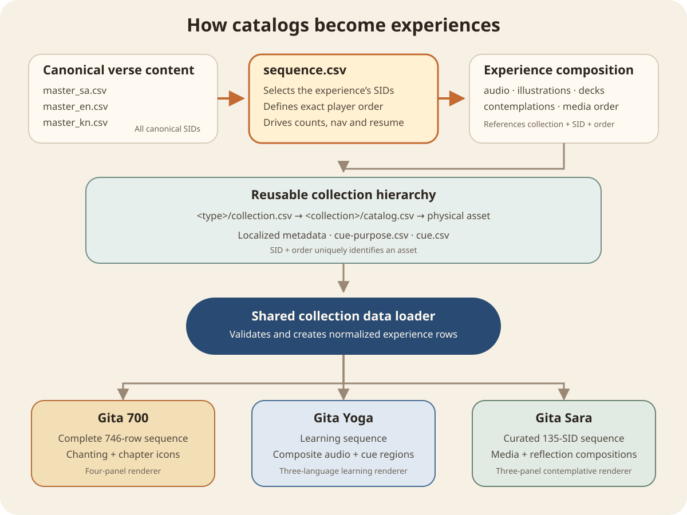

# How catalogs become experiences

**Status:** Current  
**Last updated:** 4 November 2026

MyGita separates product configuration, canonical book content, reusable media, experience composition and rendering. The same book and media collections can therefore serve different products and learning purposes without duplicating their source data.



## Shared hierarchy

```text
MyGita product configuration
products/<product>/data/
├── distribution.json
└── experiences/<experience>/experience.json + catalog.csv
              │ declares book, renderer and resource bindings
              ▼
Media root catalog
catalog.json
├── content_version
├── books[] → book/<book-id>/manifest.json
└── mounts[] → book/ · audio/ · image/ · video/ · deck/ · docs/
              │ strict logical paths
              ▼
Book manifest
book/<book-id>/manifest.json
├── canonical verse registries and language masters
├── reusable resource registries and catalogs
├── experience resources
│   ├── sequence.csv          ← selects SIDs and defines player order
│   ├── audio.csv             ← associates audio collections
│   ├── illustrations.csv     ← associates illustration collections
│   ├── contemplations.csv    ← associates questions and reflections
│   ├── decks.csv             ← associates deck descriptors
│   └── media.csv             ← orders different media types together
└── metadata-only file inventory
              │ joined by SID, collection and asset order
              ▼
Media source + book adapter → normalized experience dataset → renderer
```

`SID` identifies a verse across canonical masters, experience files, catalogs, analytics and resume state. `SID + order` identifies a particular reusable asset when one verse has multiple recordings, illustrations, questions, decks or other media. Logical paths identify owned resources independently of their physical host. The root catalog’s longest matching mount resolves each logical path for remote, PWA and local-folder use.

## The role of sequence.csv

`sequence.csv` is the authoritative selection and navigation list for an experience:

```text
position#cid#snum#sid
1#D#1#D.1
2#D#2#D.2
...
10#1#1#1.1
...
135#18#78#18.78
```

It determines:

- which canonical SIDs belong to the experience;
- the exact previous/next navigation order;
- current position and total count;
- whether a saved resume SID remains valid;
- the expected SID membership and relative order of sparse experience compositions.

It does not duplicate verse text. The loader uses each selected SID to retrieve Sanskrit, English, and Kannada content from the canonical masters, then joins the experience-specific media references.

## Gita 700

```text
Canonical Bhagavad Gita masters
              +
Complete sequence.csv: all 746 records in canonical order
              +
Swami Brahmananda chanting catalog
              +
Gita chapter-icon catalog
              ▼
Normalized Gita 700 dataset
              ▼
Four-panel renderer
Shloka · Transliteration · Meaning · Word-by-word meaning
```

Here `sequence.csv` represents the complete supported scripture journey. Audio and chapter icons are reusable collections; the Gita 700 compositions state which collection assets serve this experience.

## Gita Chant

```text
Canonical Bhagavad Gita masters
              +
Complete sequence.csv
              +
Shared chanting-audio composition
              ▼
Normalized Gita Chant dataset
              ▼
Player-4 three-script chanting renderer
Sanskrit · preferred transliteration · other transliteration
```

Gita Chant demonstrates renderer reuse. It reads the same normalized book content and shared player services as the other Gita experiences while presenting a deliberately smaller semantic subset.

## Gita Yoga

```text
Canonical Bhagavad Gita masters
              +
Complete learning sequence.csv
              +
Padma–Vijay learning-audio collection
├── catalog.csv
├── cue-purpose.csv
└── cue.csv
              ▼
Normalized Gita Yoga dataset
              ▼
Three-language learning renderer + selectable audio segments
```

The experience sequence controls verse navigation. Within the current verse, `cue.csv` locates learning segments in the composite recording and `cue-purpose.csv` supplies their localized purpose and description. Missing work-in-progress audio does not remove the verse from the sequence.

## Gita Sara

```text
Approximately 746 canonical records
              │
              │ sequence.csv selects and orders 135
              ▼
135 curated records
              +
audio.csv · illustrations.csv · contemplations.csv · decks.csv
              +
media.csv establishes cross-media order
              ▼
Normalized Gita Sara dataset
              ▼
Three-panel renderer
Shloka · Illustration/media · Reflection
```

Gita Sara demonstrates why selection is separate from canonical content. Its `sequence.csv` contains nine Dhyana records and 126 chosen Bhagavad Gita shlokas in the intended teaching order. Missing media never changes that order.

For SID `2.12`, the join is:

```text
sequence.csv
position → SID 2.12
              │
              ├── master_sa.csv → Sanskrit shloka
              ├── master_en.csv → English content
              ├── master_kn.csv → Kannada content
              ├── audio.csv → chanting collection and asset order
              ├── illustrations.csv → gita-sara-illustrations, order 1
              ├── illustration catalog → image/.../2.12-1.webp
              ├── contemplations.csv → ordered reflection questions
              └── media.csv → presentation order across media types
```

If the authored illustration association is absent or the logical asset cannot be loaded, the player displays the shared default illustration. SID `2.12` retains its curated position and all other content remains available. A deck association resolves to a logical `deck/...json` descriptor; only that descriptor contains the external Google Slides provider URL.

## Player boundary

The shared media source validates catalog schema, mounts and logical paths. The book adapter then validates identities, orders, collection references and localized metadata and produces a normalized row model. Renderers never parse catalogs, select physical hosts or contain provider paths; each renderer decides only how normalized content is presented.
